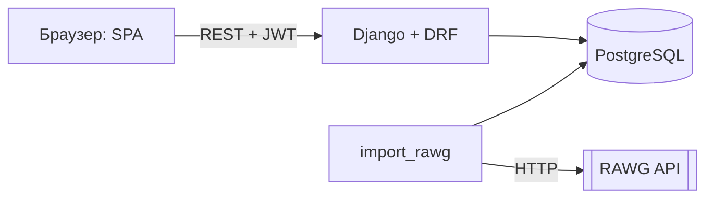

# Критик

Агрегатор отзывов на видеоигры. Пользователи ищут игры в каталоге, ставят оценки от 1 до 10, пишут короткие рецензии и собирают личный список «сыграть позже». Оценка игры — среднее по рецензиям пользователей сервиса, без оценок изданий и рекламы.

Учебный проект по дисциплине «Проектный практикум», 2026. Тема из задания — «Агрегатор отзывов на видеоигры», нетривиальная часть: сложные фильтры и сортировки, получение данных об играх из внешнего API (RAWG).


<details>
<summary>Страница игры и тёмная тема</summary>


</details>

## Возможности

- **Аккаунт:** регистрация, вход, выход. Сессия переживает перезагрузку страницы (JWT, refresh-токен в httpOnly-cookie).
- **Каталог:** поиск по названию (в том числе по-русски), фильтры по нескольким жанрам и платформам, диапазону лет, минимальной оценке и наличию рецензий. Все фильтры работают одновременно. Пять видов сортировки, вид «сетка» или «таблица», подгрузка страниц. Состояние фильтров хранится в адресе, поэтому ссылкой можно поделиться.
- **Страница игры:** сведения об игре, источник данных, оценка сообщества, гистограмма распределения оценок, рецензии с сортировкой, похожие игры.
- **Рецензии (полный CRUD):** одна рецензия на игру от пользователя. Её можно изменить или удалить, после чего средняя оценка сразу пересчитывается. Чужие рецензии изменить нельзя, это проверяет сервер.
- **Личный список** и страница **«Мои рецензии»**.
- **Импорт из RAWG API:** повторный запуск не создаёт дубликатов, ошибки провайдера пишутся в журнал, а каталог продолжает работать на сохранённых данных.
- **Администрирование:** CRUD игр, жанров и платформ, модерация рецензий, журнал импортов — в админке Django.
- Адаптивная вёрстка от 360px, светлая и тёмная тема по настройке системы.

## Стек

| Слой | Технологии |
| --- | --- |
| Backend | Python 3.13, Django 5.2, Django REST Framework 3.16, SimpleJWT |
| База данных | PostgreSQL 16 (SQLite для быстрого локального запуска) |
| Frontend | HTML, CSS, JavaScript (ES-модули, без сборщика), Fetch API |
| Внешний API | [RAWG Video Games Database](https://rawg.io/apidocs) |
| Инфраструктура | Docker, docker compose, gunicorn, WhiteNoise |
| Качество | Django TestCase (33 теста), Ruff, GitHub Actions |

## Запуск

### Предварительные требования

| Инструмент | Версия | Для чего |
| --- | --- | --- |
| Git | любая | клонирование |
| Docker Engine / Docker Desktop с docker compose v2 | 24+ (проверено на 28.0.4) | основной способ запуска. На macOS и Windows Docker Desktop должен быть запущен |
| Python | 3.13.3 (`.python-version`), подойдёт 3.12+ | только для запуска без Docker и для smoke-теста |

Ключ RAWG не нужен: без него загружается демо-каталог из 24 игр.

### Запуск в Docker (PostgreSQL + gunicorn), 3 команды

```bash
git clone <URL репозитория> kritik
cd kritik
docker compose up --build
```

При старте контейнер применяет миграции и загружает демо-каталог. Приложение открывается на <http://localhost:8000/>. Если порт 8000 занят, запустите `WEB_PORT=8080 docker compose up --build`. Для входа в админку создайте суперпользователя: `docker compose exec web python manage.py createsuperuser`.

### Запуск без Docker (SQLite), 5 команд

```bash
git clone <URL репозитория> kritik && cd kritik
python3 -m venv .venv && . .venv/bin/activate      # Windows: .venv\Scripts\activate
pip install -r requirements-dev.txt
cd src && python manage.py migrate && python manage.py seed_demo
python manage.py runserver
```

Настройки по умолчанию подходят для локального запуска. Чтобы их изменить, скопируйте `.env.example` в `.env` в корне репозитория. Для работы с PostgreSQL заполните в `.env` переменные `POSTGRES_DB`, `POSTGRES_USER`, `POSTGRES_PASSWORD` и `POSTGRES_HOST`.

### Проверка работоспособности

Пока приложение запущено, выполните в другом терминале из корня репозитория:

```bash
python3 tests/smoke_test.py http://localhost:8000
```

Скрипт проходит три шага: (1) главная страница открывается, в каталоге API есть игры; (2) новый пользователь регистрируется; (3) пользователь публикует рецензию, у игры увеличивается число рецензий и пересчитывается средняя оценка. Затем скрипт удаляет рецензию. Код возврата `0` означает, что проект работает, а в конце выводится строка «Проект работает.».

То же самое можно проверить вручную: открыть <http://localhost:8000/>, ввести в поиск «мор» и найти «Мор (Pathologic 2)», зарегистрироваться и оставить рецензию. Средняя оценка игры сразу изменится.

### Протокол проверки запуска

| Дата | ОС и окружение | Способ | Кто проверял | Результат |
| --- | --- | --- | --- | --- |
| 19.10.2026 | macOS (Darwin 25.4), Docker Desktop 28.0.4 | Чистый `git clone` ветки `lab-1`, затем `docker compose up --build`, затем `tests/smoke_test.py` | Лазарев Ю. (прогон выполнен с помощью Claude Code) | Успешно: сборка ≈ 36 с, smoke-тест пройден |
| 19.10.2026 | Debian GNU/Linux 12, чистый контейнер `python:3.13.3-slim` без кэша pip | Чистая копия репозитория, затем команды из раздела «Запуск без Docker», затем `tests/smoke_test.py`, `ruff check .`, `manage.py test` | Лазарев Ю. (прогон выполнен с помощью Claude Code) | Успешно: smoke-тест пройден, 33 теста OK, линтер без замечаний |

## Импорт игр из RAWG

1. Получите бесплатный ключ на <https://rawg.io/apidocs> и запишите его в `.env` как `RAWG_API_KEY`.
2. Загрузите игры:

```bash
cd src
python manage.py import_rawg --pages 3 --ordering -rating          # 120 популярных игр
python manage.py import_rawg --search "hollow knight" --details    # с описаниями
```

Итог каждого запуска виден в админке в разделе «Import runs». Жанры и платформы демо-каталога используют те же slug, что и RAWG, поэтому после импорта в фильтрах не появятся дубликаты.

## Тесты и линтер

```bash
cd src && python manage.py test     # 33 автотеста
cd .. && ruff check .               # линтер
```

CI (`.github/workflows/ci.yml`) на каждый push и pull request запускает линтер, проверку миграций, тесты на PostgreSQL и сборку Docker-образа. Чек-лист ручной проверки — в [docs/testing.md](docs/testing.md).

## API

Кратко (подробно, с параметрами и примерами ответов — в [docs/api.md](docs/api.md)):

| Метод | Путь | Назначение |
| --- | --- | --- |
| POST | `/api/auth/register/`, `/api/auth/login/`, `/api/auth/refresh/`, `/api/auth/logout/` | Аккаунт и сессия |
| GET | `/api/auth/me/` | Текущий пользователь |
| GET | `/api/games/?search=&genre=&platform=&year_from=&year_to=&rating_min=&reviewed=&ordering=&page=` | Каталог |
| GET | `/api/games/{id}/`, `/api/games/{id}/reviews/` | Игра и её рецензии |
| GET | `/api/games/filters/`, `/api/games/stats/` | Значения фильтров, сводка |
| POST, PATCH, DELETE | `/api/reviews/`, `/api/reviews/{id}/` | CRUD своей рецензии |
| GET | `/api/me/reviews/` | Мои рецензии |
| GET, POST, DELETE | `/api/me/saved-games/`, `/api/me/saved-games/{game_id}/` | Личный список |

## Архитектура



Схема компонентов, ER-диаграмма и сценарии — в [docs/architecture.md](docs/architecture.md).

```text
README.md                описание, запуск, статус требований
CHANGELOG.md             история изменений
LICENSE                  лицензия MIT
docs/00-project.md       паспорт проекта, структура, карта функций, практики, план на семестр
docs/01-…05-*.md         требования, валидация, архитектура, тестирование, выпуск (ЛР 2–6)
docs/adr/                архитектурные решения (ЛР 4)
docs/diagrams/           исходники диаграмм
docs/api.md, architecture.md, backlog.md, testing.md, process.md   документация, написанная до ЛР 1
src/manage.py            точка входа Django
src/config/              настройки Django, корневые URL
src/accounts/            пользователь, регистрация, JWT и refresh-cookie
src/games/               игры, жанры, платформы, фильтры, клиент RAWG, команды import_rawg и seed_demo
src/reviews/             рецензии и права автора
src/saved_games/         личный список
src/frontend/            шаблон страницы и статика: css/kritik.css, js/app.js, js/api.js, js/ui.js
tests/                   smoke-тест (автотесты пока в src/<app>/tests.py, перенос в ЛР 5)
docker/, Dockerfile, docker-compose.yml, .github/workflows/ci.yml   инфраструктура и CI
```

Подробный разбор структуры, точек входа и конфигурации приведён в [docs/00-project.md](docs/00-project.md).
## Команда

Работа индивидуальная.

| Участник | Роль | Зона ответственности |
| --- | --- | --- |
| Лазарев Юрий | Владелец продукта, разработчик, QA | всё: требования, архитектура, код, тесты, выпуск |

Бэклог и пользовательские истории описаны в [docs/backlog.md](docs/backlog.md), паспорт проекта и план на семестр в [docs/00-project.md](docs/00-project.md).

## Статус требований

Спецификация требований (UR-n, FR-n, NFR-n) появится в лабораторной работе 2 в файле `docs/01-requirements.md`, после этого здесь будет таблица статусов. До неё функции перечислены в карте функций [docs/00-project.md](docs/00-project.md#4-карта-функций): все функции Ф1–Ф9 реализованы.

## Правила ведения репозитория

- Каждая лабораторная работа делается в ветке `lab-N` и попадает в `main` только через pull request. Прямые коммиты в `main` запрещены защитой ветки. После слияния на итоговый коммит ставится тег `lab-N`.
- Метки issues: `review`, `bug`, `change-request`, `question`. Замечания преподавателя оформляются как issues и закрываются коммитами со ссылкой `Closes #N`.
- Начиная с ЛР 2 идентификаторы UR-n, FR-n, NFR-n, CR-n и T-n указываются в коммитах, issues, коде и тестах.
- Проект собственный, а не форк, поэтому синхронизация с upstream не нужна.

## Ограничения и планы

- Без ключа RAWG каталог состоит из 24 игр демо-набора с демо-рецензиями от учётных записей `*-demo`, у которых нет пароля и в которые нельзя войти.
- Обложки RAWG загружаются напрямую с их CDN. Если обложки нет, показывается типографская обложка.
- В планах: полезность рецензий, публичные профили, рекомендации на основе оценок.
