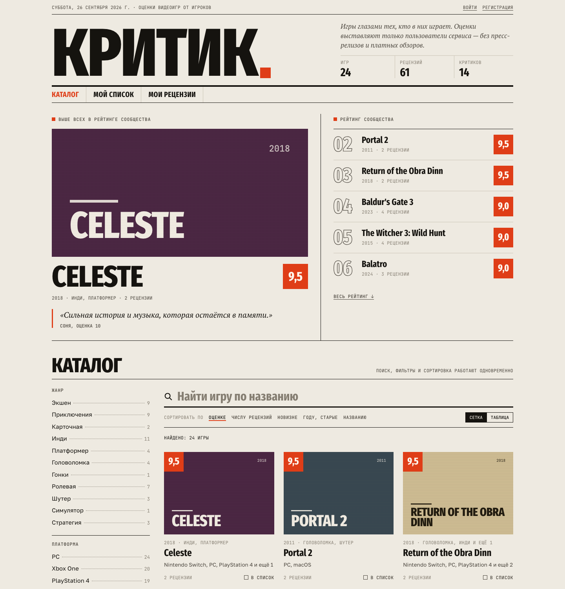
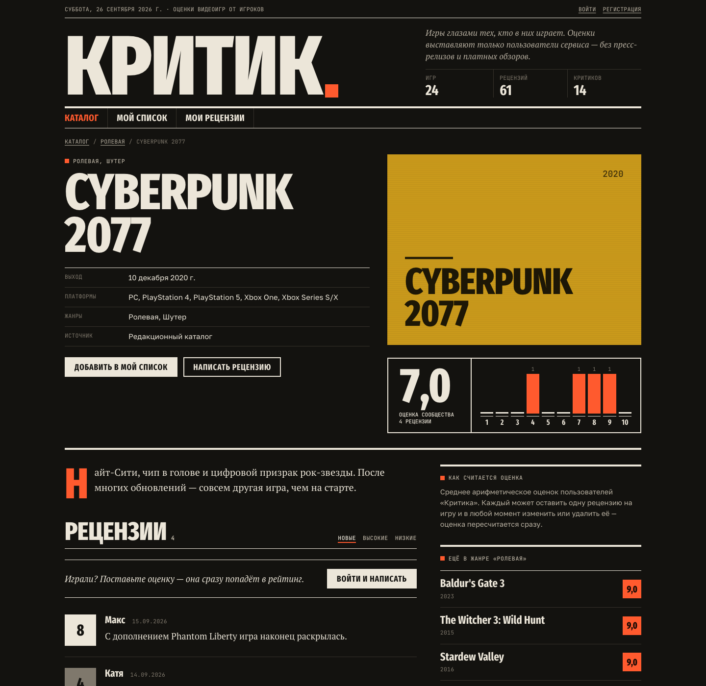
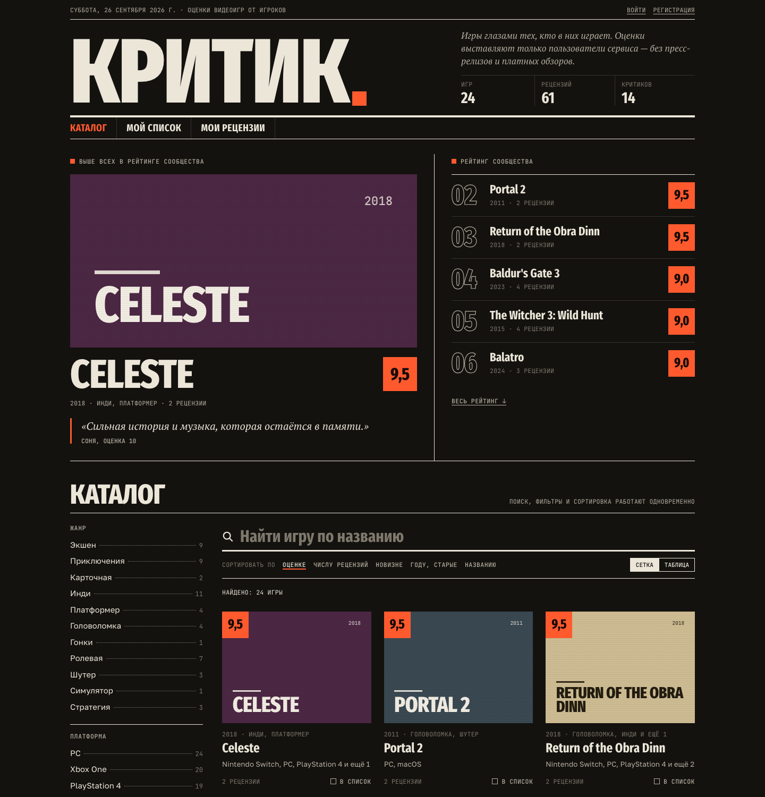
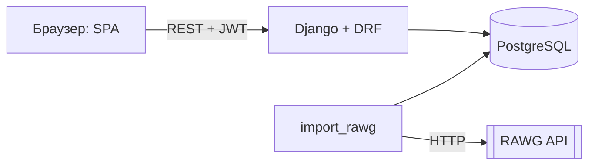

# Критик

Агрегатор отзывов на видеоигры. Пользователи ищут игры в каталоге, ставят оценки от 1 до 10, пишут короткие рецензии и собирают личный список «сыграть позже». Оценка игры — среднее по рецензиям пользователей сервиса, без оценок изданий и рекламы.

Учебный проект по дисциплине «Проектный практикум», 2026. Тема из задания — «Агрегатор отзывов на видеоигры», нетривиальная часть: сложные фильтры и сортировки, получение данных об играх из внешнего API (RAWG).



<details>
<summary>Страница игры и тёмная тема</summary>



</details>

## Возможности

- **Аккаунт:** регистрация, вход, выход. Сессия переживает перезагрузку страницы (JWT, refresh-токен в httpOnly-cookie).
- **Каталог:** поиск по названию (в том числе по-русски), фильтры по нескольким жанрам и платформам, диапазону лет, минимальной оценке и наличию рецензий. Все фильтры работают одновременно. Пять видов сортировки, вид «сетка» или «таблица», подгрузка страниц. Состояние фильтров хранится в адресе, поэтому ссылкой можно поделиться.
- **Страница игры:** сведения об игре, источник данных, оценка сообщества, гистограмма распределения оценок, рецензии с сортировкой, похожие игры.
- **Рецензии (полный CRUD):** одна рецензия на игру от пользователя. Её можно изменить или удалить, после чего средняя оценка сразу пересчитывается. Чужие рецензии изменить нельзя, это проверяет сервер.
- **Личный список** и страница **«Мои рецензии»**.
- **Импорт из RAWG API:** повторный запуск не создаёт дубликатов, ошибки провайдера пишутся в журнал, а каталог продолжает работать на сохранённых данных.
- **Администрирование:** CRUD игр, жанров и платформ, модерация рецензий, журнал импортов — в админке Django.
- Адаптивная вёрстка от 360px, светлая и тёмная тема по настройке системы.

## Стек

| Слой | Технологии |
| --- | --- |
| Backend | Python 3.13, Django 5.2, Django REST Framework 3.16, SimpleJWT |
| База данных | PostgreSQL 16 (SQLite для быстрого локального запуска) |
| Frontend | HTML, CSS, JavaScript (ES-модули, без сборщика), Fetch API |
| Внешний API | [RAWG Video Games Database](https://rawg.io/apidocs) |
| Инфраструктура | Docker, docker compose, gunicorn, WhiteNoise |
| Качество | Django TestCase (33 теста), Ruff, GitHub Actions |

## Быстрый старт (локально, SQLite)

Нужен Python 3.12+.

```bash
python3 -m venv .venv
source .venv/bin/activate            # Windows: .venv\Scripts\activate
pip install -r requirements-dev.txt
cp .env.example .env                  # при необходимости поменяйте значения
python manage.py migrate
python manage.py seed_demo            # 24 игры и демо-рецензии
python manage.py createsuperuser      # для входа в /admin/
python manage.py runserver
```

Откройте <http://127.0.0.1:8000/>. Админка: <http://127.0.0.1:8000/admin/>.

Чтобы работать с PostgreSQL вместо SQLite, заполните в `.env` переменные `POSTGRES_DB`, `POSTGRES_USER`, `POSTGRES_PASSWORD`, `POSTGRES_HOST`.

## Запуск в Docker (PostgreSQL + gunicorn)

```bash
docker compose up --build
```

Приложение будет доступно на <http://localhost:8000/>. При старте контейнер применяет миграции и загружает демо-каталог. Если задать `RAWG_API_KEY` и `IMPORT_RAWG_PAGES`, он дополнительно импортирует игры из RAWG:

```bash
RAWG_API_KEY=ваш_ключ IMPORT_RAWG_PAGES=3 docker compose up --build
docker compose exec web python manage.py createsuperuser
```

Для сервера с доменом задайте `DJANGO_ALLOWED_HOSTS`, `DJANGO_CSRF_TRUSTED_ORIGINS`, свой `DJANGO_SECRET_KEY`, а при HTTPS — `JWT_COOKIE_SECURE=true`.

## Импорт игр из RAWG

1. Получите бесплатный ключ на <https://rawg.io/apidocs> и запишите его в `.env` как `RAWG_API_KEY`.
2. Загрузите игры:

```bash
python manage.py import_rawg --pages 3 --ordering -rating          # 120 популярных игр
python manage.py import_rawg --search "hollow knight" --details    # с описаниями
```

Итог каждого запуска виден в админке в разделе «Import runs». Жанры и платформы демо-каталога используют те же slug, что и RAWG, поэтому после импорта в фильтрах не появятся дубликаты.

## Тесты и линтер

```bash
python manage.py test
ruff check .
```

CI (`.github/workflows/ci.yml`) на каждый push и pull request запускает линтер, проверку миграций, тесты на PostgreSQL и сборку Docker-образа. Чек-лист ручной проверки — в [docs/testing.md](docs/testing.md).

## API

Кратко (подробно, с параметрами и примерами ответов — в [docs/api.md](docs/api.md)):

| Метод | Путь | Назначение |
| --- | --- | --- |
| POST | `/api/auth/register/`, `/api/auth/login/`, `/api/auth/refresh/`, `/api/auth/logout/` | Аккаунт и сессия |
| GET | `/api/auth/me/` | Текущий пользователь |
| GET | `/api/games/?search=&genre=&platform=&year_from=&year_to=&rating_min=&reviewed=&ordering=&page=` | Каталог |
| GET | `/api/games/{id}/`, `/api/games/{id}/reviews/` | Игра и её рецензии |
| GET | `/api/games/filters/`, `/api/games/stats/` | Значения фильтров, сводка |
| POST, PATCH, DELETE | `/api/reviews/`, `/api/reviews/{id}/` | CRUD своей рецензии |
| GET | `/api/me/reviews/` | Мои рецензии |
| GET, POST, DELETE | `/api/me/saved-games/`, `/api/me/saved-games/{game_id}/` | Личный список |

## Архитектура



Схема компонентов, ER-диаграмма и сценарии — в [docs/architecture.md](docs/architecture.md).

```text
config/        настройки Django, корневые URL
accounts/      пользователь, регистрация, JWT и refresh-cookie
games/         игры, жанры, платформы, фильтры, клиент RAWG, команды import_rawg и seed_demo
reviews/       рецензии и права автора
saved_games/   личный список
frontend/      шаблон страницы и статика: css/kritik.css, js/app.js, js/api.js, js/ui.js
docs/          API, архитектура, бэклог, тестирование, процесс
```

## Команда

| Участник | Роль | Зона ответственности |
| --- | --- | --- |
| _ФИО_ | Team Lead / Backend | архитектура, API, БД, код-ревью |
| _ФИО_ | Product Manager / Frontend | бэклог, истории, интерфейс, презентация |
| _ФИО_ | DevOps & QA / Backend | импорт RAWG, тесты, CI, деплой |

Бэклог и пользовательские истории — [docs/backlog.md](docs/backlog.md). Правила работы с Git, шаблоны отчётов и протоколов — [docs/process.md](docs/process.md).

## Ограничения и планы

- Без ключа RAWG каталог состоит из 24 игр демо-набора с демо-рецензиями от учётных записей `*-demo`, у которых нет пароля и в которые нельзя войти.
- Обложки RAWG загружаются напрямую с их CDN. Если обложки нет, показывается типографская обложка.
- В планах: полезность рецензий, публичные профили, рекомендации на основе оценок.
