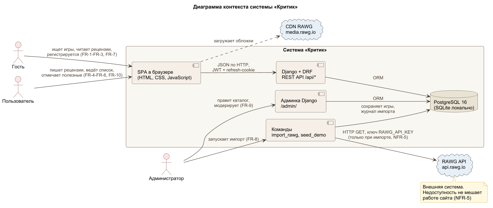
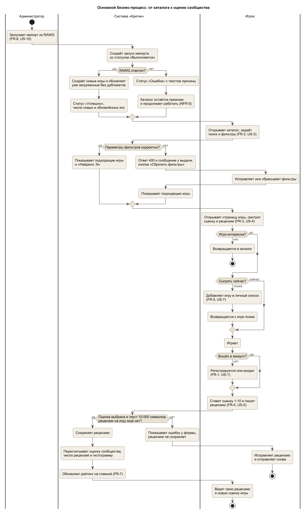
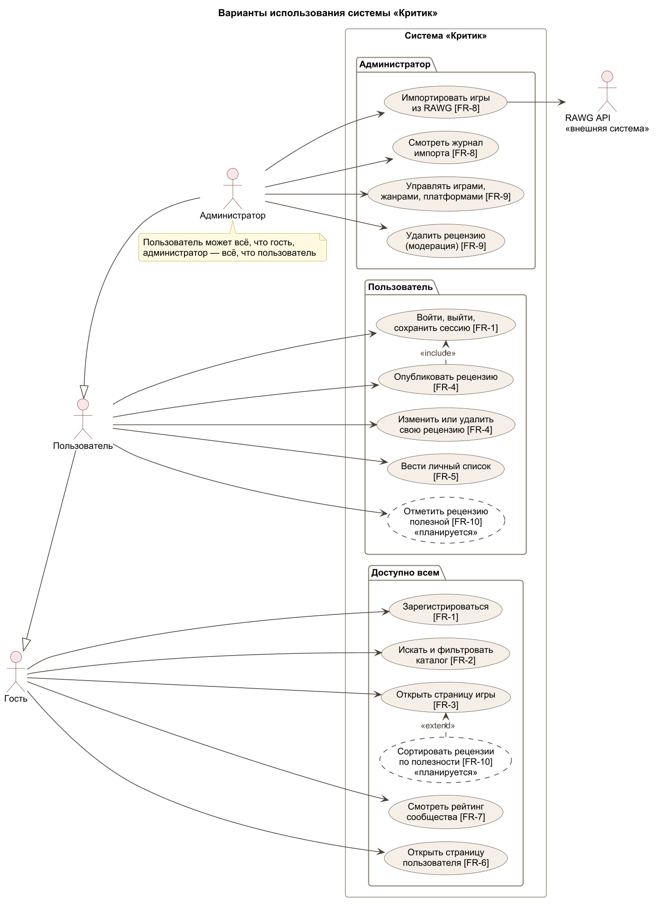
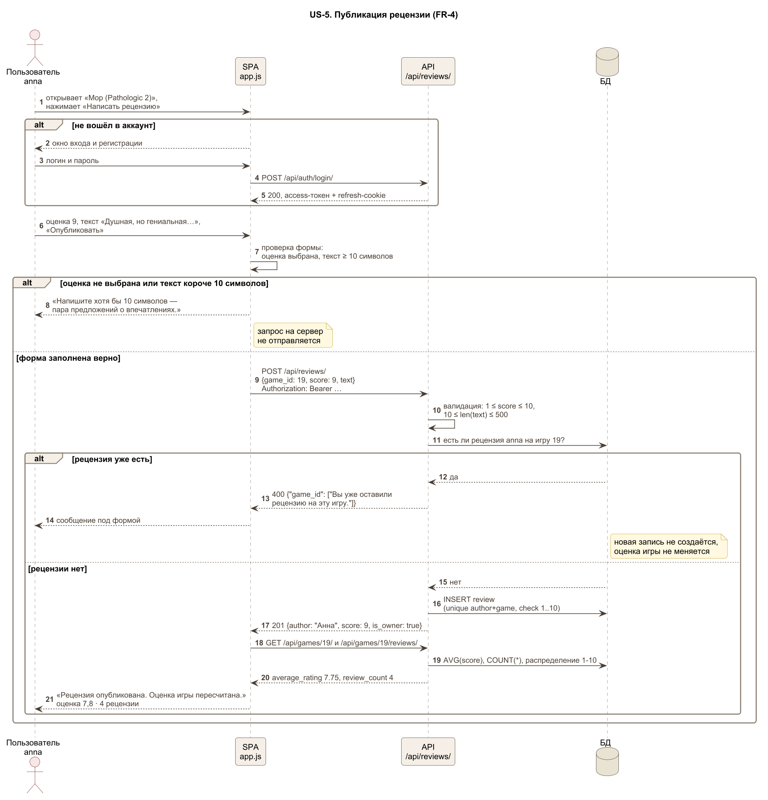
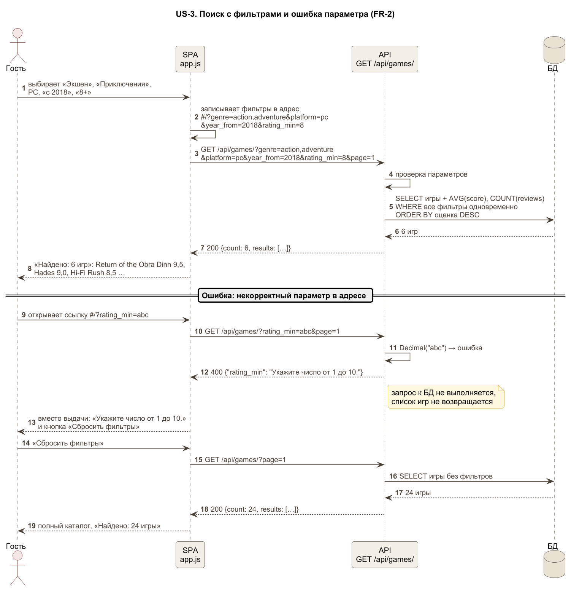
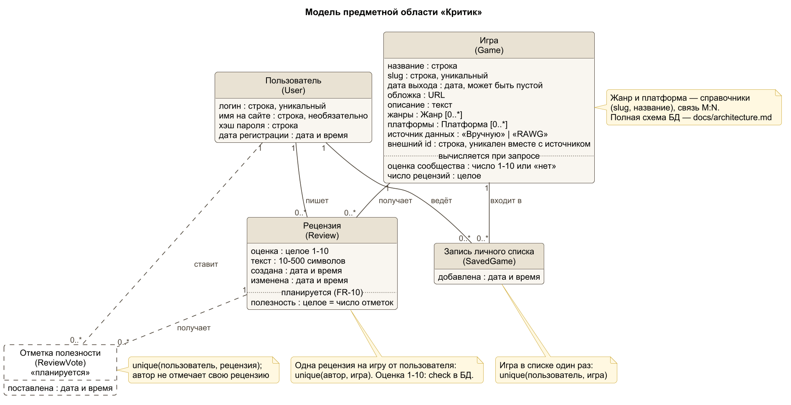
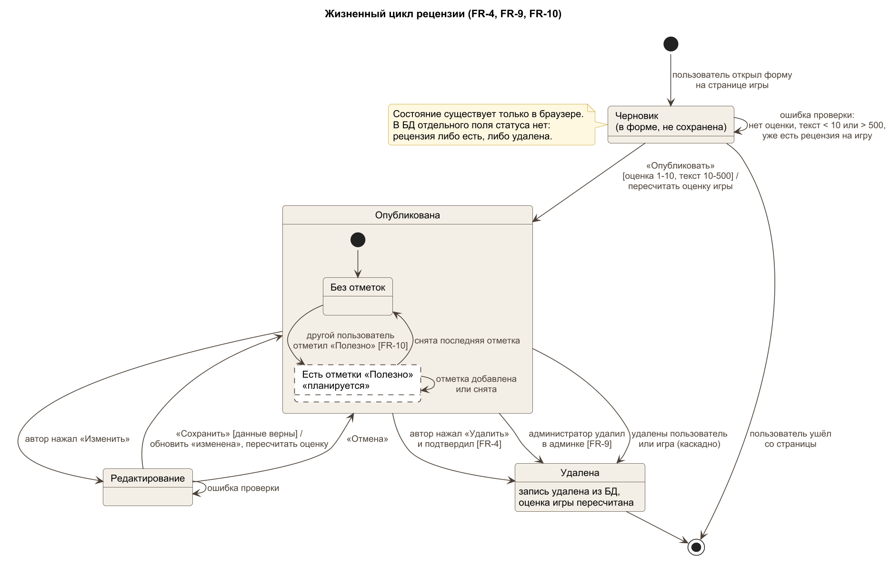
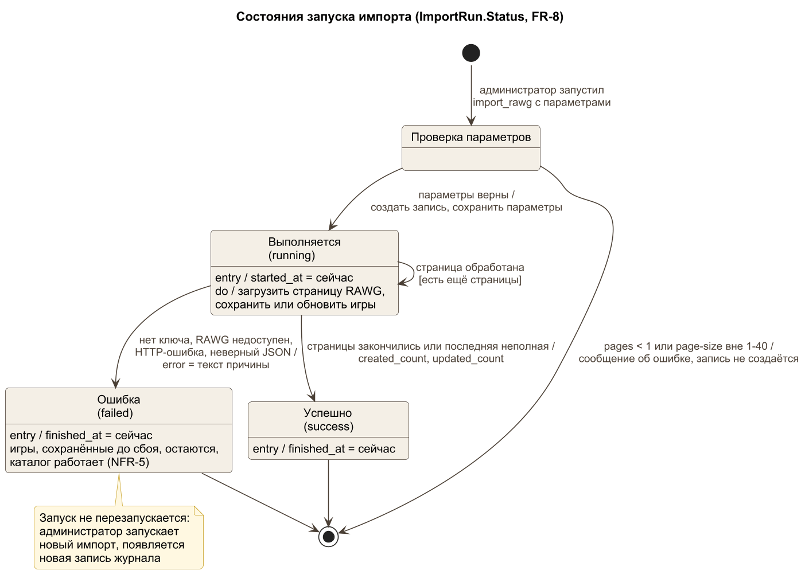

# Требования к проекту «Критик»

| Поле | Значение |
| --- | --- |
| Версия документа | **1.0** (05.11.2026) |
| Лабораторная работа | № 2 «Описание проекта и требования», ветка `lab-2` |
| Ответственный | Щербаков Марк (аналитик). Разделы 1–2 и раздел 3 — Щербаков, диаграммы раздела 4 — Стругов, сверка с кодом и README — Лазарев |
| Связанные документы | [паспорт проекта](00-project.md), [API](api.md), [архитектура](architecture.md), [исходники диаграмм](diagrams/) |

Идентификаторы `FR-n` (требование к функционалу), `NFR-n` (ограничение) и `US-n` (пользовательский сценарий) не меняются до конца семестра. На них ссылаются диаграммы, pull request'ы, коммиты, а начиная с ЛР 3 также код и тесты. Если требование отменяется, его номер не переиспользуется: требование помечается как отменённое.

> **Номера бэклога.** В [docs/backlog.md](backlog.md), написанном до курса, истории тоже назывались `US-1`…`US-13`. Чтобы номера не путались, в ЛР 2 они переименованы в `BL-1`…`BL-13`. Сценарии `US-n` из этого документа с ними не совпадают; соответствие приведено в [разделе 3.4](#34-соответствие-бэклогу).

Условные обозначения состояния: ✅ уже есть, 🔧 нужно доработать, 🆕 нужно сделать.

## 1. О приложении

### 1.1. Какую задачу решает

Игроку, который выбирает следующую игру, трудно понять, стоит ли она его времени. Оценки в магазинах и у изданий смешаны с маркетингом, а мнения игроков разбросаны по форумам и не сводятся к короткому ответу «стоит или нет».

«Критик» — веб-приложение, в котором каталог игр собирается из открытой базы RAWG, а по каждой игре показываются только оценки и рецензии пользователей сервиса: средняя оценка, распределение оценок от 1 до 10 и короткие тексты. Каталог можно искать и фильтровать по нескольким признакам одновременно, а интересные игры откладывать в личный список «сыграть позже».

### 1.2. Кто пользуется (роли)

| Роль | Кто это | Что делает в системе |
| --- | --- | --- |
| **Гость** | Посетитель без аккаунта | Ищет и фильтрует каталог, открывает страницу игры, читает рецензии, смотрит рейтинг сообщества, регистрируется |
| **Пользователь** | Зарегистрированный игрок, вошедший в аккаунт | Всё, что гость, а также пишет, изменяет и удаляет свою рецензию, ведёт личный список, смотрит свои рецензии, отмечает чужие рецензии полезными (планируется) |
| **Администратор** | Сотрудник, отвечающий за каталог | Импортирует игры из RAWG, создаёт, изменяет и удаляет игры, жанры и платформы, удаляет рецензии, нарушающие правила, смотрит журнал импорта |
| **RAWG API** | Внешняя система `api.rawg.io` | Отдаёт сведения об играх по запросу импорта. Сама в систему ничего не отправляет |

### 1.3. Что приложение уже умеет

На момент начала ЛР 2 (ветка `lab-1`, коммит `5feedfc`) приложение запускается командой `docker compose up --build` и проходит smoke-тест. Работают все девять функций Ф1–Ф9 из [карты функций паспорта](00-project.md#4-карта-функций):

- регистрация, вход и выход, сессия сохраняется после перезагрузки страницы;
- каталог с поиском по названию (в том числе по-русски), фильтрами по жанрам, платформам, годам, минимальной оценке и наличию рецензий, пятью сортировками, видом «сетка» и «таблица»;
- страница игры со средней оценкой, гистограммой оценок, рецензиями и похожими играми;
- создание, изменение и удаление своей рецензии с пересчётом средней оценки;
- личный список «сыграть позже» и страница «Мои рецензии»;
- рейтинг сообщества и сводка каталога на главной;
- импорт игр из RAWG с журналом запусков, демо-каталог из 24 игр для работы без ключа;
- администрирование каталога и рецензий в админке Django.

Не реализованы: отметки полезности рецензий и публичная страница пользователя. Они входят в объём семестра (FR-10, FR-6).

### 1.4. Термины

Эти же имена используются в модели данных (раздел 4) и в интерфейсе.

| Термин | Значение | Модель в коде |
| --- | --- | --- |
| **Игра** | Карточка игры в каталоге: название, дата выхода, обложка, описание, жанры, платформы, источник данных | `games.Game` |
| **Жанр**, **платформа** | Справочники для фильтров. У игры может быть несколько жанров и платформ | `games.Genre`, `games.Platform` |
| **Каталог** | Все игры, доступные для поиска. Пополняется импортом или вручную администратором | — |
| **Источник данных** | Откуда взята игра: «Вручную» или «RAWG». У игры из RAWG хранится внешний идентификатор и ссылка на страницу в RAWG | `Game.data_source` |
| **Рецензия** | Оценка пользователя от 1 до 10 и текст от 10 до 500 символов. У пользователя не больше одной рецензии на игру | `reviews.Review` |
| **Оценка сообщества** (средняя оценка) | Среднее арифметическое оценок всех рецензий игры, показывается с одним знаком после запятой. Если рецензий нет, показывается «Нет оценок», а не 0 | вычисляется при запросе |
| **Распределение оценок** | Сколько раз игре поставили 1, 2, …, 10. Показывается гистограммой | `score_distribution` в API |
| **Критик** | Пользователь, у которого есть хотя бы одна рецензия. Отсюда название сервиса и счётчик «критиков» на главной | — |
| **Выбор сообщества** | Отметка у игры со средней оценкой 9,0 и выше | — |
| **Личный список** («сыграть позже») | Игры, которые пользователь отложил на потом. Виден только владельцу | — |
| **Запись личного списка** | Одна игра в личном списке пользователя и время её добавления | `saved_games.SavedGame` |
| **Импорт** | Загрузка игр из RAWG командой `import_rawg`. Повторный импорт обновляет игры, а не создаёт дубликаты | `games.rawg` |
| **Запуск импорта** | Запись журнала об одном импорте: параметры, статус («Выполняется», «Успешно», «Ошибка»), число новых и обновлённых игр, текст ошибки | `games.ImportRun` |
| **Демо-каталог** | 24 игры и рецензии от учётных записей `*-demo`, которые загружаются командой `seed_demo`, чтобы приложение работало без ключа RAWG | `seed_demo` |
| **Отметка полезности** | Отметка «Полезно», которую пользователь ставит чужой рецензии. Планируется (FR-10) | `reviews.ReviewVote` (будет) |
| **Сессия** | Время, в течение которого пользователь остаётся авторизованным без повторного входа, — до 7 дней | refresh-токен |

## 2. Требования

### 2.1. Требования к функционалу

Приоритет: **обязательно** — входит в объём семестра и должно работать к ЛР 6; **желательно** — делается, если хватит времени; **потом** — за пределами семестра.

| № | Требование | Приоритет | Состояние | Признак выполнения |
| --- | --- | --- | --- | --- |
| **FR-1** | Гость может зарегистрироваться по логину и паролю, а пользователь — войти, выйти и оставаться авторизованным после перезагрузки страницы до 7 дней. | обязательно | ✅ уже есть | После регистрации в шапке написано «Вы вошли как ‹имя›»; после перезагрузки страницы он остаётся авторизован; после «Выйти» и перезагрузки он гость; неверный пароль, слабый пароль, несовпадение паролей и занятый логин дают сообщение у формы, а аккаунт не создаётся |
| **FR-2** | Гость может найти игру по части названия, в том числе на русском, и сузить каталог одновременно по нескольким жанрам, платформам, диапазону лет, минимальной оценке и наличию рецензий, выбрать одну из пяти сортировок и поделиться ссылкой на результат. | обязательно | ✅ уже есть | Запрос «мор» находит «Мор (Pathologic 2)»; при сочетании фильтров счётчик «Найдено» равен числу игр в выдаче, и каждая игра подходит под все фильтры; ссылка, открытая в новой вкладке, показывает ту же выдачу; некорректное значение фильтра даёт понятное сообщение, а не ошибку страницы |
| **FR-3** | Гость может открыть страницу игры и увидеть её сведения, источник данных, оценку сообщества, число рецензий, распределение оценок от 1 до 10, рецензии с сортировкой «новые», «высокие», «низкие» и до пяти похожих игр. | обязательно | ✅ уже есть | Для игры с рецензиями показаны средняя оценка с одним знаком после запятой и гистограмма, сумма столбцов которой равна числу рецензий; для игры без рецензий написано «Нет оценок»; у игры из RAWG есть ссылка на источник; для несуществующей игры показывается «Не найдено. Такой игры нет в каталоге.» |
| **FR-4** | Пользователь может опубликовать на игру одну рецензию с оценкой от 1 до 10 и текстом от 10 до 500 символов, а затем изменить или удалить её, и оценка сообщества сразу пересчитывается. | обязательно | ✅ уже есть | После публикации, изменения и удаления средняя оценка, число рецензий и гистограмма на странице игры меняются без перезагрузки; вторая рецензия на ту же игру не создаётся; чужую рецензию изменить или удалить нельзя ни из интерфейса, ни прямым запросом к API |
| **FR-5** | Пользователь может добавить игру в личный список «сыграть позже» из каталога или со страницы игры, посмотреть список и убрать из него игру. | обязательно | ✅ уже есть | Игра появляется в «Моём списке» первой, счётчик в меню увеличивается; список сохраняется после выхода и входа; игра не попадает в список дважды; другой пользователь этот список не видит; гостю при нажатии «В список» предлагается войти |
| **FR-6** | Гость может открыть публичную страницу пользователя со всеми его рецензиями, числом рецензий и средней оценкой, которую он ставит, а сам пользователь может перейти с неё к редактированию своей рецензии. | желательно | 🔧 нужно доработать | Имя автора у рецензии ведёт на страницу `#/user/<логин>`; страница открывается без входа и показывает те же рецензии, что видит автор в «Моих рецензиях»; у автора есть кнопка «Изменить»; для несуществующего логина выводится «Пользователь не найден». Сейчас есть только закрытая страница «Мои рецензии» |
| **FR-7** | Гость может на главной странице увидеть рейтинг сообщества — игру с наивысшей оценкой, цитату из её рецензии и следующие пять мест — и сводку каталога: число игр, рецензий и критиков. | желательно | ✅ уже есть | Без фильтров на главной видны лидер рейтинга и пять следующих игр в порядке убывания оценки; после публикации рецензии число рецензий в сводке увеличивается на 1; при включении любого фильтра блок рейтинга скрывается |
| **FR-8** | Администратор может загрузить игры из RAWG по популярности или поисковому запросу, повторно обновить уже загруженные игры без дубликатов и увидеть итог каждого запуска в журнале импорта. | обязательно | ✅ уже есть | Новые игры появляются в каталоге с источником «RAWG»; повторный запуск с теми же параметрами не меняет число игр; в журнале у запуска статус «Успешно» и число новых и обновлённых игр; при отсутствии ключа или сети запуск получает статус «Ошибка» с текстом причины, а каталог продолжает открываться |
| **FR-9** | Администратор может создавать, изменять и удалять игры, жанры и платформы и удалять рецензии, нарушающие правила. | обязательно | ✅ уже есть | Игра, созданная в админке, находится поиском в каталоге; после удаления рецензии администратором она пропадает со страницы игры, а оценка сообщества пересчитывается; пользователь без прав администратора не может открыть `/admin/` |
| **FR-10** | Пользователь может отметить чужую рецензию как полезную и снять отметку, а любой посетитель может отсортировать рецензии игры по полезности. | обязательно | 🆕 нужно сделать | У рецензии виден счётчик «Полезно: N»; нажатие увеличивает его на 1, повторное нажатие отменяет отметку; свою рецензию отметить нельзя; одна отметка от пользователя на рецензию сохраняется после перезагрузки; сортировка «полезные» ставит выше рецензии с большим счётчиком; гостю при нажатии предлагается войти |

**За пределами семестра** (приоритет «потом», номера FR не присваиваются, пока требование не будет принято в работу): персональные рекомендации по оценкам (BL-12), уведомления о новых рецензиях на игры из списка (BL-13), подписки и комментарии к рецензиям, импорт по расписанию, мобильное приложение.

### 2.2. Ограничения

| № | Ограничение | Состояние | Как проверить |
| --- | --- | --- | --- |
| **NFR-1** | **Платформы.** Интерфейс работает в двух последних версиях Chrome, Firefox, Safari и Edge на компьютере и телефоне. При ширине окна от 360 до 1920 px на страницах каталога, игры и «Мой список» нет горизонтальной прокрутки, а все кнопки доступны. | ✅ уже есть | Открыть три страницы в каждом браузере при ширине 360, 768 и 1440 px. `document.documentElement.scrollWidth` не больше ширины окна |
| **NFR-2** | **Время ответа.** На каталоге из 1000 игр и 10 000 рецензий запрос каталога `GET /api/games/` с любым сочетанием фильтров и сортировок отвечает не дольше 500 мс для 95 % запросов, а главная страница полностью открывается не дольше 2 с при локальном запуске в Docker. | 🔧 нужно доработать: на демо-каталоге ответ ≈ 130 мс, на 1000 игр не проверялось (issue [#4](https://github.com/zrmiles/kritik/issues/4)) | Скрипт нагрузки генерирует данные и делает 200 запросов с разными фильтрами, считает 95-й перцентиль. Время загрузки главной — по вкладке Network браузера |
| **NFR-3** | **Защита данных.** Пароли хранятся только в виде хэша и не короче 8 символов, не из списка распространённых и не только из цифр. Refresh-токен хранится в cookie с флагом `HttpOnly`, недоступной JavaScript, access-токен живёт 5 минут. Изменить или удалить рецензию и личный список может только их владелец. При `DJANGO_DEBUG=false` приложение не запускается без собственного `DJANGO_SECRET_KEY`. | 🔧 нужно доработать: проверка ключа не сделана (issue [#2](https://github.com/zrmiles/kritik/issues/2)) | Автотесты прав: запрос не-автора к чужой рецензии получает `404`; в таблице пользователей нет паролей в открытом виде; `document.cookie` в браузере не содержит `kritik_refresh`; запуск с `DJANGO_DEBUG=false` без ключа завершается ошибкой |
| **NFR-4** | **Технологии и запуск.** Backend на Python 3.13 и Django 5.2 с DRF, основная БД PostgreSQL 16, интерфейс на JavaScript без сборщика. Приложение запускается на чистой машине тремя командами (`git clone`, `cd`, `docker compose up --build`) не дольше чем за 5 минут, без ключа RAWG и без ручной настройки. | ✅ уже есть | Протокол проверки запуска в README: чистый `git clone`, запуск, `tests/smoke_test.py` возвращает код 0 |
| **NFR-5** | **Независимость от RAWG.** Каталог, страницы игр и рецензии работают, когда RAWG недоступен или ключ не задан: ошибка импорта не влияет на ответы сайта, а приложение не обращается к RAWG при открытии страниц. Данные RAWG показываются с указанием источника и ссылкой на RAWG. | ✅ уже есть, атрибуция уточняется (issue [#3](https://github.com/zrmiles/kritik/issues/3)) | Запустить импорт без сети: запуск получает статус «Ошибка», а `GET /api/games/` отвечает `200`. Во вкладке Network при работе с сайтом нет запросов к `api.rawg.io` |

## 3. Пользовательские сценарии

Сценарии записаны по схеме «Я как ‹роль› имею ‹вход›, делаю ‹действия›, получаю ‹результат›». Сценарии US-1, US-3 и US-5 — **ключевые**: для них приведены конкретный пример и поведение при неверных данных. Значения в примерах взяты из демо-каталога (`seed_demo`) и проверены запросами к API на чистой базе 05.11.2026.

### 3.1. Сценарии

#### US-1. Регистрация нового игрока · FR-1 · ключевой

Я как **гость** имею логин, пароль и желаемое имя на сайте, делаю: нажимаю в шапке «Регистрация», заполняю логин, имя, пароль и повтор пароля, нажимаю «Создать аккаунт»; получаю аккаунт, сразу вхожу в него и вижу в шапке «Вы вошли как ‹имя›».

- **Вход:** логин (обязательно, уникальный), имя на сайте (необязательно), пароль и повтор пароля.
- **Выход:** сообщение «Аккаунт создан. Добро пожаловать, ‹имя›.», в шапке «Вы вошли как ‹имя›», в меню доступны «Мой список» и «Мои рецензии». В системе: новая запись пользователя с хэшем пароля, refresh-cookie `kritik_refresh` на 7 дней.

**Пример.**

| Поле | Значение |
| --- | --- |
| Логин | `anna` |
| Имя на сайте | `Анна` |
| Пароль и повтор | `Kritik-2026!` и `Kritik-2026!` |

Ожидаемый результат: `POST /api/auth/register/` возвращает `201` и `{"user": {"username": "anna", "display_name": "Анна", "public_name": "Анна"}, "access": "…", "access_expires_in": 300}`, браузер получает cookie `kritik_refresh` с флагом `HttpOnly`. На экране сообщение «Аккаунт создан. Добро пожаловать, Анна.», в шапке «Вы вошли как Анна». После перезагрузки страницы пользователь остаётся авторизован.

**Неверные или неполные данные.**

| Что ввёл гость | Что видит | Чего система не делает |
| --- | --- | --- |
| Пароль `12345` | Ответ `400`, у формы сообщения «Введённый пароль слишком короткий. Он должен состоять из как минимум 8 символов.», «Введённый пароль слишком широко распространён.», «Введённый пароль состоит только из цифр.» | Не создаёт пользователя, не выдаёт токен и cookie |
| Повтор пароля `Kritik-2026?` | `400`, у поля повтора «Пароли не совпадают.» | То же |
| Логин `anna`, который уже занят | `400`, у поля логина «Пользователь с таким именем уже существует.» | Не изменяет существующий аккаунт |
| При входе логин `anna` и пароль `wrong` | `401`, сообщение «Неверное имя пользователя или пароль.» | Не выдаёт токен, не сообщает, что именно неверно: логин или пароль |

#### US-2. Возвращение на сайт и выход · FR-1

Я как **пользователь** имею аккаунт и открытую сессию, делаю: закрываю вкладку, через день снова открываю сайт, работаю, затем нажимаю «Выйти»; получаю: при открытии я уже авторизован без ввода пароля, а после выхода и перезагрузки страницы становлюсь гостем.

- **Вход:** refresh-cookie, выданная при входе не более 7 дней назад.
- **Выход:** имя в шапке без повторного входа; после «Выйти» сообщение «Вы вышли из аккаунта.», refresh-токен отозван, cookie удалена.

#### US-3. Поиск игры по названию и фильтрам · FR-2 · ключевой

Я как **гость** имею представление о том, во что хочу играть (жанр, платформа, годы, «не ниже 8»), делаю: ввожу часть названия или выбираю в боковой панели жанры, платформу, «с 2018 года» и «8+», при необходимости меняю сортировку и копирую ссылку; получаю список подходящих игр с числом найденных и ссылку, которая открывает ту же выдачу.

- **Вход:** строка поиска; жанры и платформы (несколько); год «с» и «по»; минимальная оценка 1–10; флажок «только с рецензиями»; сортировка: по оценке, по числу рецензий, новые, старые, по названию.
- **Выход:** карточки или строки таблицы с названием, годом, жанрами, оценкой сообщества и числом рецензий; строка «Найдено: N»; активные фильтры, которые можно снять по одному; адрес страницы с параметрами фильтров. В системе ничего не меняется.

**Пример 1 — поиск по-русски.** Строка поиска `мор` (адрес `#/?search=мор`). Ожидаемый результат: «Найдено: 1 игра» — «Мор (Pathologic 2)», 2019, оценка сообщества 7,3, 3 рецензии. Запрос `GET /api/games/?search=мор` возвращает `count: 1`.

**Пример 2 — сочетание фильтров.** Жанры «Экшен» и «Приключения», платформа PC, с 2018 года, оценка от 8, сортировка по оценке. Адрес: `#/?genre=action,adventure&platform=pc&year_from=2018&rating_min=8`. Ожидаемый результат: «Найдено: 6 игр» в порядке:

| Место | Игра | Оценка сообщества |
| --- | --- | --- |
| 1 | Return of the Obra Dinn | 9,5 |
| 2 | Hades | 9,0 |
| 3 | Hi-Fi Rush | 8,5 |
| 4 | It Takes Two | 8,5 |
| 5 | Outer Wilds | 8,3 |
| 6 | Red Dead Redemption 2 | 8,3 |

Если открыть эту ссылку в новой вкладке, выдача и отмеченные фильтры совпадают.

**Неверные или неполные данные.** Параметры фильтров можно изменить вручную в адресе, поэтому сервер проверяет каждый из них.

| Адрес или ввод | Что видит пользователь | Чего система не делает |
| --- | --- | --- |
| `#/?rating_min=abc` | API отвечает `400 {"rating_min": "Укажите число от 1 до 10."}`. Вместо выдачи сообщение «Укажите число от 1 до 10.» и кнопка «Сбросить фильтры» | Не показывает список игр, не игнорирует параметр молча, не возвращает ошибку `500` |
| `#/?year_from=2022&year_to=2018` | `400`, сообщение «Конец периода не может быть раньше начала.» | Не меняет годы местами и не показывает пустой список, как будто игр нет |
| `#/?ordering=price` | `400`, сообщение «Допустимые значения: rating, reviews, newest, oldest, title.» | Не применяет сортировку по умолчанию без предупреждения |
| `?year=str` (прямой запрос к API) | `400 {"year": "Укажите целое число."}` | То же |
| Корректные фильтры, под которые нет игр, например поиск `zzz` | «Пусто. Под такие условия не подошла ни одна игра…», «Найдено: 0 игр», кнопка «Сбросить фильтры» | Это не ошибка: ответ `200` с `count: 0` |

#### US-4. Решение по странице игры · FR-3

Я как **гость** имею игру, найденную в каталоге, делаю: открываю её страницу, смотрю оценку сообщества и гистограмму, переключаю сортировку рецензий на «низкие», читаю критику, перехожу к похожей игре; получаю представление о том, стоит ли играть, и при желании переход к похожей игре.

- **Вход:** идентификатор игры в адресе `#/game/<id>`, выбранная сортировка рецензий.
- **Выход:** название, обложка, дата выхода, жанры, платформы, описание, источник данных (для RAWG — ссылка), оценка сообщества или «Нет оценок», число рецензий, гистограмма 1–10, список рецензий с автором, оценкой и датой, до пяти похожих игр. В системе ничего не меняется. Для несуществующего `id` сервер отвечает `404`, а на экране сообщение «Не найдено. Такой игры нет в каталоге.» и ссылка в каталог.

#### US-5. Публикация рецензии · FR-4 · ключевой

Я как **пользователь** имею аккаунт, сыгранную игру и мнение о ней, делаю: открываю страницу игры, выбираю оценку на шкале 1–10, пишу текст и нажимаю «Опубликовать»; получаю свою рецензию на странице игры вместо формы и пересчитанную оценку сообщества.

- **Вход:** токен пользователя (вход выполнен), игра, оценка 1–10, текст 10–500 символов.
- **Выход:** сообщение «Рецензия опубликована. Оценка игры пересчитана.»; моя рецензия первой в списке с кнопками «Изменить» и «Удалить»; новые оценка сообщества, число рецензий и гистограмма; рецензия в «Моих рецензиях»; на главной число рецензий в сводке больше на 1. В системе: новая запись рецензии.

**Пример.** Пользователь `anna` (имя «Анна»), игра «Мор (Pathologic 2)». До публикации: оценка 7,3 (точно 7,33), 3 рецензии, по одной оценке 3, 9 и 10. Ввод: оценка **9**, текст «Душная, но гениальная игра про чуму и выбор.» (44 символа).

Ожидаемый результат: `POST /api/reviews/` с телом `{"game_id": 19, "score": 9, "text": "Душная, но гениальная игра про чуму и выбор."}` возвращает `201` и `{"author": "Анна", "is_owner": true, "score": 9, …}`. На странице игры: оценка **7,8** (7,75 = (3 + 9 + 10 + 9) / 4), **4 рецензии**, столбец «9» гистограммы вырос с 1 до 2. Рецензия Анны первая в списке.

**Неверные или неполные данные.**

| Что произошло | Что видит пользователь | Чего система не делает |
| --- | --- | --- |
| Гость нажимает «Написать рецензию» | Окно входа и регистрации; после входа он возвращается к форме. Прямой запрос без токена получает `401 {"detail": "Учетные данные не были предоставлены."}` | Не создаёт рецензию без автора |
| Оценка не выбрана | Под формой «Выберите оценку от 1 до 10.» | Не отправляет запрос на сервер |
| Текст «Ок» (2 символа) | «Напишите хотя бы 10 символов — пара предложений о впечатлениях.» | Не отправляет запрос. Если отправить его напрямую, сервер отвечает `400 {"text": ["Убедитесь, что это значение содержит не менее 10 символов (сейчас 2)."]}` |
| Оценка 11 в прямом запросе к API | `400 {"score": ["Убедитесь, что это значение меньше либо равно 10."]}` | Не сохраняет рецензию: кроме проверки в API, оценку 1–10 ограничивает правило в БД |
| Вторая рецензия на ту же игру (повторная отправка или вторая вкладка) | `400`, сообщение «Вы уже оставили рецензию на эту игру.» | Не создаёт вторую рецензию; оценка сообщества и число рецензий не меняются |

#### US-6. Изменение и удаление своей рецензии · FR-4

Я как **пользователь** имею опубликованную рецензию, делаю: нажимаю «Изменить», меняю оценку или текст и сохраняю; позже нажимаю «Удалить» и подтверждаю; получаю обновлённую, а затем удалённую рецензию и каждый раз пересчитанную оценку сообщества.

- **Вход:** своя рецензия, новые оценка и текст, подтверждение удаления.
- **Выход:** «Рецензия обновлена. Оценка игры пересчитана.»; после удаления на месте рецензии снова форма. Для примера из US-5: после изменения оценки 9 → 5 оценка «Мора» 6,8 (6,75), рецензий по-прежнему 4; после удаления — 7,3 и 3 рецензии. Запрос на изменение чужой рецензии получает `404`, рецензия не меняется.

#### US-7. Личный список «сыграть позже» · FR-5

Я как **пользователь** имею игру, в которую хочу сыграть потом, делаю: нажимаю «В список» на карточке в каталоге, позже открываю «Мой список», нахожу игру и снова нажимаю на её кнопку «В списке»; получаю отложенную игру в списке, а затем список без неё.

- **Вход:** токен пользователя, игра.
- **Выход:** «Игра добавлена в ваш список.», кнопка меняется на «В списке», счётчик в меню +1; в «Моём списке» игры, новые сверху; после повторного нажатия — «Игра убрана из списка.». На странице игры те же действия выполняют кнопки «Добавить в мой список» и «Убрать из списка». Повторное добавление получает `400` «Игра уже находится в вашем списке.», гость видит предложение войти.

#### US-8. Рецензии пользователя на его странице · FR-6

Я как **гость** имею рецензию, автор которой мне понравился, делаю: нажимаю на имя автора у рецензии; получаю публичную страницу автора со всеми его рецензиями, их числом и его средней оценкой и решаю, доверять ли его вкусу.

- **Вход:** логин автора в адресе `#/user/<логин>`.
- **Выход:** имя автора, число рецензий, средняя оценка, которую он ставит, список рецензий со ссылками на игры, новые сверху. Автор на своей странице видит кнопки «Изменить». Для несуществующего логина — «Пользователь не найден» и ответ `404`. Сейчас доступна только закрытая страница «Мои рецензии» для самого автора.

#### US-9. Рейтинг сообщества на главной · FR-7

Я как **гость** имею желание начать с проверенного, делаю: открываю главную страницу без фильтров; получаю лучшую игру по версии сообщества с цитатой из рецензии, следующие пять мест рейтинга и сводку «игр, рецензий, критиков».

- **Вход:** нет; используются все рецензии в системе.
- **Выход:** блок рейтинга и сводка. На демо-каталоге сводка: 24 игры, 61 рецензия, 14 критиков. После включения любого фильтра блок скрывается.

#### US-10. Пополнение каталога из RAWG · FR-8

Я как **администратор** имею ключ RAWG в `.env` и доступ к серверу, делаю: запускаю `python manage.py import_rawg --pages 3 --ordering -rating`, затем открываю в админке «Import runs»; получаю 120 популярных игр в каталоге и запись о запуске со статусом «Успешно» и числом новых и обновлённых игр.

- **Вход:** ключ `RAWG_API_KEY`, параметры `--pages`, `--page-size` (1–40), `--search`, `--ordering`, `--details`.
- **Выход:** игры с источником «RAWG» в каталоге, жанры и платформы в фильтрах без дубликатов, запуск импорта в журнале. Повторный запуск с теми же параметрами обновляет игры, число игр не растёт. Без ключа или без сети: запуск получает статус «Ошибка» с текстом, например «Не задан RAWG_API_KEY…» или «RAWG недоступен: …», команда завершается с ошибкой, а уже сохранённый каталог открывается как обычно. При `--page-size 50` команда сразу завершается сообщением «--pages должен быть не меньше 1, а --page-size — от 1 до 40.» и не обращается к RAWG.

#### US-11. Модерация рецензии · FR-9

Я как **администратор** имею учётную запись с правами администратора и жалобу на оскорбительную рецензию, делаю: вхожу в `/admin/`, нахожу рецензию по игре и автору, удаляю её; получаю страницу игры без этой рецензии и пересчитанную оценку сообщества.

- **Вход:** логин и пароль администратора, игра и автор рецензии.
- **Выход:** рецензия удалена, оценка сообщества и число рецензий пересчитаны, у автора рецензия пропала из «Моих рецензий». Пользователь без прав администратора на `/admin/` видит форму входа, а не данные.

#### US-12. Отметка «Полезно» у чужой рецензии · FR-10 · планируется

Я как **пользователь** имею прочитанную чужую рецензию, которая помогла мне решить, делаю: нажимаю «Полезно» под рецензией, позже передумываю и нажимаю ещё раз; получаю счётчик полезности, увеличенный на 1, а затем возвращённый к прежнему значению.

- **Вход:** токен пользователя, чужая рецензия.
- **Выход:** счётчик «Полезно: N», подсвеченная кнопка; в системе отметка полезности. Отметить свою рецензию нельзя: кнопка неактивна, прямой запрос получает `400`. Вторая отметка той же рецензии не создаётся. Гость видит предложение войти.

#### US-13. Полезные рецензии сначала · FR-10 · планируется

Я как **гость** имею страницу игры с большим числом рецензий, делаю: выбираю сортировку рецензий «полезные»; получаю рецензии в порядке убывания счётчика «Полезно», при равенстве — новые сверху.

- **Вход:** игра, сортировка `helpful`.
- **Выход:** упорядоченный список рецензий; в системе ничего не меняется.

### 3.2. Таблица «требование → сценарии»

| Требование | Сценарии | Состояние |
| --- | --- | --- |
| FR-1 Аккаунт и сессия | US-1, US-2 | ✅ |
| FR-2 Поиск, фильтры, сортировки | US-3 | ✅ |
| FR-3 Страница игры | US-4 | ✅ |
| FR-4 Своя рецензия | US-5, US-6 | ✅ |
| FR-5 Личный список | US-7 | ✅ |
| FR-6 Страница пользователя | US-8 | 🔧 |
| FR-7 Рейтинг сообщества | US-9 | ✅ |
| FR-8 Импорт из RAWG | US-10 | ✅ |
| FR-9 Администрирование и модерация | US-11 | ✅ |
| FR-10 Полезность рецензий | US-12, US-13 | 🆕 |

У каждого требования есть хотя бы один сценарий, у каждого из 13 сценариев указано ровно одно требование.

### 3.3. Ограничения в сценариях

| Ограничение | Где проявляется |
| --- | --- |
| NFR-1 Платформы | US-3, US-4, US-7 (страницы проверяются на 360 px) |
| NFR-2 Время ответа | US-3, US-9 |
| NFR-3 Защита данных | US-1, US-2, US-5, US-6, US-7, US-11 |
| NFR-4 Технологии и запуск | все сценарии на демо-каталоге |
| NFR-5 Независимость от RAWG | US-4, US-10 |

### 3.4. Соответствие бэклогу

| Бэклог (до курса) | Требования и сценарии |
| --- | --- |
| BL-1 Регистрация и вход | FR-1: US-1, US-2 |
| BL-2 Каталог из внешнего API | FR-8: US-10 |
| BL-3 Поиск, фильтры, сортировки | FR-2: US-3 |
| BL-4 Страница игры | FR-3: US-4 |
| BL-5 Своя рецензия | FR-4: US-5, US-6 |
| BL-6 Личный список | FR-5: US-7 |
| BL-7 Мои рецензии | FR-6: US-8 |
| BL-8 Рейтинг сообщества | FR-7: US-9 |
| BL-9 Табличный вид каталога | FR-2: US-3 (вид «таблица») |
| BL-10 Полезность рецензий | FR-10: US-12, US-13 |
| BL-11 Публичный профиль | FR-6: US-8 |
| BL-12, BL-13 | за пределами семестра |

## 4. Модели системы

Исходники диаграмм написаны на PlantUML и лежат в [docs/diagrams/](diagrams/) рядом с экспортом в PNG. Модели восстановлены по существующему коду (проект собственный, ядро уже реализовано) и дополнены планируемыми частями: они выделены пунктиром или пометкой «планируется».

Как пересобрать изображения после правки исходника:

```bash
java -jar plantuml.jar -tpng docs/diagrams/*.puml
```

| № | Точка зрения | Диаграмма | Назначение | Файлы | Иллюстрирует |
| --- | --- | --- | --- | --- | --- |
| 1 | Контекст | Диаграмма контекста | Границы системы: что входит в «Критик», кто с ним работает и с какими внешними системами он связан | [context.puml](diagrams/context.puml), [context.png](diagrams/context.png) | роли раздела 1.2; FR-1–FR-10; NFR-4, NFR-5 |
| 2 | Контекст | Диаграмма деятельности | Основной бизнес-процесс: каталог пополняется из RAWG, игрок выбирает игру, пишет рецензию, и его оценка становится частью оценки сообщества | [activity-main.puml](diagrams/activity-main.puml), [activity-main.png](diagrams/activity-main.png) | FR-2, FR-3, FR-4, FR-5, FR-8; US-3, US-4, US-5, US-7, US-10 |
| 3 | Взаимодействие | Диаграмма вариантов использования | Что может делать каждая роль. Каждый вариант использования подписан номером требования | [use-cases.puml](diagrams/use-cases.puml), [use-cases.png](diagrams/use-cases.png) | FR-1–FR-10, все US |
| 4 | Взаимодействие | Диаграмма последовательности «Публикация рецензии» | Обмен сообщениями между пользователем, SPA, API и БД при публикации рецензии: вход для гостя, проверка формы, ошибки `400`, пересчёт оценки | [seq-publish-review.puml](diagrams/seq-publish-review.puml), [seq-publish-review.png](diagrams/seq-publish-review.png) | FR-4; US-5 (включая таблицу неверных данных) |
| 5 | Взаимодействие | Диаграмма последовательности «Поиск с фильтрами и ошибка параметра» | Как фильтры попадают в адрес и в запрос, как сервер отклоняет некорректный параметр кодом `400` и что видит пользователь | [seq-catalog-filters.puml](diagrams/seq-catalog-filters.puml), [seq-catalog-filters.png](diagrams/seq-catalog-filters.png) | FR-2; US-3 (оба примера и таблица неверных данных) |
| 6 | Структура | Диаграмма классов предметной области | Пять сущностей — пользователь, игра, рецензия, запись личного списка, отметка полезности — с атрибутами, связями и ограничениями. Жанры и платформы показаны как справочники игры | [domain-model.puml](diagrams/domain-model.puml), [domain-model.png](diagrams/domain-model.png) | термины раздела 1.4; FR-2–FR-6, FR-10 |
| 7 | События | Диаграмма состояний «Рецензия» | Жизненный цикл рецензии: черновик в форме, опубликована, изменена, удалена автором или администратором; планируемые отметки полезности | [state-review.puml](diagrams/state-review.puml), [state-review.png](diagrams/state-review.png) | FR-4, FR-9, FR-10; US-5, US-6, US-11, US-12 |
| 8 | События | Диаграмма состояний «Запуск импорта» | Статусы запуска импорта «Выполняется», «Успешно», «Ошибка» в точности как в коде (`ImportRun.Status`) | [state-import-run.puml](diagrams/state-import-run.puml), [state-import-run.png](diagrams/state-import-run.png) | FR-8, NFR-5; US-10 |

### 4.1. Контекст



В границы системы входят SPA в браузере, сервер Django с API и админкой, команды `import_rawg` и `seed_demo` и база данных. Снаружи остаются три роли и две внешние системы: RAWG API, к которому обращается только команда импорта, и CDN RAWG, с которого браузер загружает обложки. Поэтому недоступность RAWG не мешает работе сайта (NFR-5).



### 4.2. Взаимодействие







### 4.3. Структура



Имена сущностей совпадают с терминами раздела 1.4. Служебные модели (`ImportRun`, таблицы токенов) в модель предметной области не включены; полная схема БД — в [docs/architecture.md](architecture.md#модель-данных). Сущность «Отметка полезности» пока не реализована (FR-10).

### 4.4. События

Объект с явным жизненным циклом в проекте — **запуск импорта**: его статус хранится в поле и меняется командой. У **рецензии** статуса в БД нет, но её жизненный цикл важен для требований FR-4, FR-9 и FR-10, поэтому для неё тоже построена диаграмма. Отдельного статуса модерации нет: администратор удаляет рецензию, а не скрывает.





## История документа

| Версия | Дата | Изменения |
| --- | --- | --- |
| 1.0 | 05.11.2026 | Первая версия: разделы 1–4, FR-1–FR-10, NFR-1–NFR-5, US-1–US-13, восемь диаграмм |
