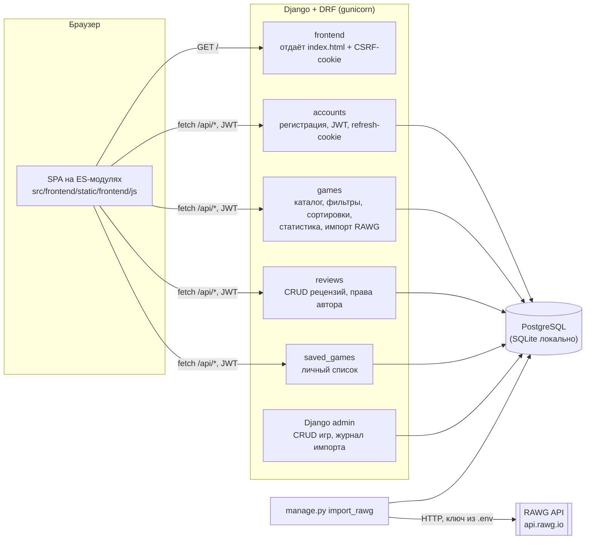
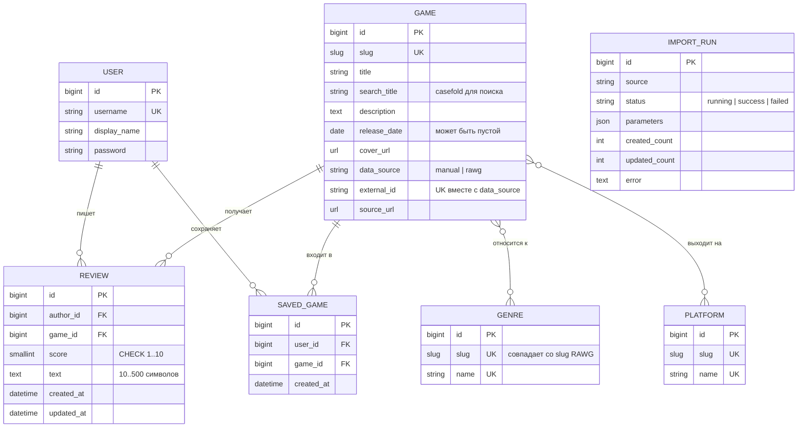
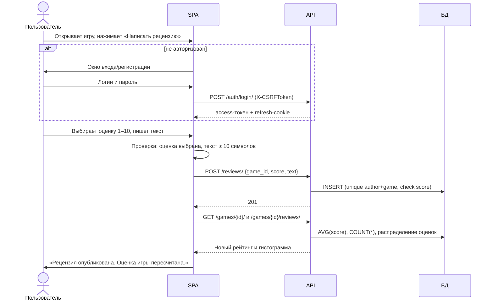

# Архитектура

## Компоненты

- **Где авторизация.** `accounts` выдаёт JWT. Права проверяются во view: запись рецензий и личный список требуют токен, а выборка рецензий для изменения ограничена `author = request.user`, поэтому чужие рецензии недоступны (`404`).
- **Где считается рейтинг.** `GameQuerySet.with_review_stats()` добавляет к запросу `Avg(score)` и `Count(reviews)`. Рейтинг не хранится отдельным полем, поэтому не может разойтись с рецензиями.
- **Где фильтрация.** `src/games/views.py → GameQuerySetMixin.filter_queryset_params`. Фильтры по жанрам и платформам сделаны подзапросами `pk__in`, а не join: иначе при выборе нескольких жанров строки игры размножились бы и исказили агрегаты.
- **Поиск по кириллице.** SQLite сравнивает без учёта регистра только латиницу, поэтому у игры есть служебное поле `search_title` (название в `casefold()`), оно заполняется при сохранении.
- **Фронтенд** — одностраничное приложение без сборщика. Экраны переключаются по хешу (`#/game/5`), а состояние фильтров хранится в адресе (`#/?genre=action&rating_min=8`), поэтому работают кнопка «Назад» и ссылки на результаты поиска.

## Модель данных

Ограничения на уровне БД:

- `unique(author, game)` — одна рецензия на игру от пользователя;
- `check(1 <= score <= 10)`;
- `unique(user, game)` — игра не попадает в список дважды;
- `unique(data_source, external_id) where external_id is not null` — повторный импорт не создаёт дубликаты.

## Сценарий: пользователь пишет рецензию

## Сессия после перезагрузки страницы

Access-токен живёт только в памяти вкладки. При загрузке SPA вызывает `POST /auth/refresh/`: если refresh-cookie на месте, сервер выдаёт новый access-токен и пользователь снова авторизован. Если access-токен истёк во время работы, клиент получает `401`, один раз обновляет токен и повторяет запрос (`src/frontend/static/frontend/js/api.js`).
